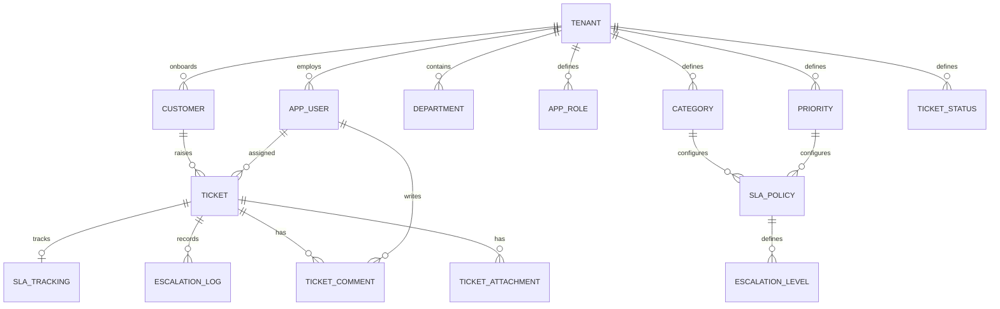

# ER diagram and relational schema

The supplied ER and relational-schema images are the conceptual baseline. The implemented schema adds explicit tenant-aware composite foreign keys to enforce isolation at the database boundary.

## Relational schema
- TENANT(tenant_id PK, name, subdomain UQ, plan, is_active, created_at)
- DEPARTMENT(department_id PK, tenant_id FK, name, UQ(tenant_id,name))
- APP_ROLE(role_id PK, tenant_id FK, role_name, UQ(tenant_id,role_name))
- APP_USER(user_id PK, tenant_id FK, department_id FK, role_id FK, name, email, password_hash, is_active, created_at)
- CUSTOMER(customer_id PK, tenant_id FK, name, email, phone, company)
- CATEGORY(category_id PK, tenant_id FK, name, description)
- PRIORITY(priority_id PK, tenant_id FK, name, level_rank)
- TICKET_STATUS(status_id PK, tenant_id FK, name, is_closed_status)
- TICKET(ticket_id PK, tenant_id FK, customer_id FK, category_id FK, priority_id FK, status_id FK, assigned_to FK, created_by FK, subject, description, timestamps)
- SLA_POLICY(sla_policy_id PK, tenant_id FK, category_id FK, priority_id FK, response_time_minutes, resolution_time_minutes, business_hours_only)
- SLA_TRACKING(sla_tracking_id PK, tenant_id FK, ticket_id FK/UQ, sla_policy_id FK, due/response/resolution timestamps, breach flags)
- ESCALATION_LEVEL(escalation_level_id PK, tenant_id FK, sla_policy_id FK, level_number, trigger_after_minutes, escalate_to_role_id FK, notify_email)
- ESCALATION_LOG(escalation_log_id PK, tenant_id FK, ticket_id FK, escalation_level_id FK, escalated_to_user_id FK, triggered_at, resolved_flag)
- TICKET_COMMENT(comment_id PK, tenant_id FK, ticket_id FK, user_id FK, customer_id FK, comment_text, is_internal, created_at)
- TICKET_ATTACHMENT(attachment_id PK, tenant_id FK, ticket_id FK, comment_id FK, uploaded_by FK, file_name, file_path, uploaded_at)

See `db/001_schema.sql` for exact types and constraints.
